This page takes a DefectDojo Pro instance from its first login to being ready for the EU Cyber
Resilience Act (CRA): the settings to turn on once, what to record on each product in scope, what
to load for each release, how to handle an Article 14 report, and how to produce evidence each
period. Each step says where to click, starting from the left menu, and what you should see when
it worked.

The features it configures are described in full on their own pages:
[Regulatory Profile](../regulatory_profile/), [CRA Article 14 Reporting](../cra_article14_reporting/)
and [CRA and DORA Evidence Packs](../eu_evidence_packs/).

Everything here works with a standard DefectDojo Pro licence. None of it needs the PSIRT Advisory
Engine.

DefectDojo records facts, tracks deadlines and assembles evidence. It does not decide whether the
CRA applies to a product, which class the product is in, or whether a requirement is met. Those are
your organization's determinations; confirm them with qualified legal and compliance reviewers.

The examples use one product throughout: an **IoT Gateway** Asset whose release 4.1 ships
`log4j-core` 2.13.2, and so carries Log4Shell (CVE-2021-44228). Use your own products and values.

## Before you start

| Requirement | Why | How to check |
| --- | --- | --- |
| **DefectDojo Pro 3.4.201 or later** | Earlier releases do not check Article 14 deadlines on a standard licence, and do not compute VH-5, VH-6 or the RP requirements | The version in the page footer, or ask DefectDojo Support |
| A superuser account | Feature flags, SLA configurations and dashboards are instance settings | **Settings > Feature Flags** is in your left menu |
| Edit permission on each product's Asset | The Regulatory card, SBOM imports, Article 14 reports and assessments are per Asset | The **Regulatory** card on the Asset shows an active **Submit** button |
| Each product as an Asset | Everything in this guide is recorded per Asset | **Explore > Assets** in the left menu |
| Background task processing (self-hosted only) | SBOM import, enrichment, deadline checks and evidence packs run as background tasks | Ask your administrator to confirm the workers are running |

### Decide these first

The settings below record decisions your organization makes. Have them ready before you start:

| Decision | Recorded in | CRA reference |
| --- | --- | --- |
| Which of your products are products with digital elements on the EU market | The **Regulatory** card and the CRA regulation, per product (Steps 6 and 7) | Article 2 |
| Each product's class: default, important (Class I or II) or critical | **CRA Product Class** (Step 6) | Articles 7 and 8, Annexes III and IV |
| How long each product is supported | **Support Period End** (Step 6) | Article 13(8) |
| Where vulnerability reports go, and your disclosure policy | **Security Contact** and **Disclosure Policy URL** (Step 6) | Annex I Part II, points 5 and 6 |
| How fast you remediate, by severity | An SLA configuration (Step 4) | Annex I Part II, point 2 |
| Who decides that you are aware of an actively exploited vulnerability, and who submits to ENISA | Your process; DefectDojo tracks the statutory clocks (Part 4) | Article 14 |
| How often you assess each product | The assessment period (Step 13) | — |

## Part 1 — Configure the instance

Do these once, as a superuser.

### Step 1 — Turn on the features

In the left menu, go to **Settings > Feature Flags**. Type each feature's name in **Search Feature
Flags** and switch it on in the **Enabled** column:

| Feature (as shown) | What it gives you |
| --- | --- |
| **Regulatory Profile** | The **Regulatory** card on each Asset, the **CRA Article 14 Reports** page, and the Article 14 deadline checks and notifications |
| **Compliance** | The **Compliance** tab on each Asset. It may already be on |
| **EU Evidence Packs** | CRA assessments and evidence packs. Needs **Compliance** |
| **Locations** | The component inventory that SBOM imports write. It may already be on. It cannot be switched off once on, and asks you to confirm |

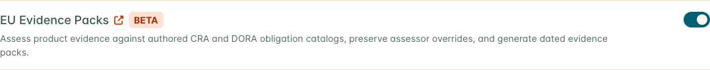

No restart is needed. Leave every other flag as it is; this guide does not use them. See
[Feature Flags](/admin/feature_flags/pro__feature_flags/).

| Expected | Where |
| --- | --- |
| **CRA Article 14 Reports** under **Act** | The left menu |
| A **Regulatory** card near the top of every Asset page | Any Asset |
| An **EU Evidence** tab | Asset > **Asset Overview** > **Compliance** tab > **Compliance Profile** |

### Step 2 — Enable per-release SBOMs

This one is a deployment setting, not a feature flag. On DefectDojo Cloud, ask DefectDojo Support
to set `DD_V3_ASSET_VERSIONS=True` on your instance. On a self-hosted install, your administrator
sets the environment variable `DD_V3_ASSET_VERSIONS=True` and restarts DefectDojo.

It lets each SBOM import name the release it describes, so you can show later which release carried
which component. Without it, every SBOM lands on the Asset as a whole.

| Expected | Where |
| --- | --- |
| A **Version** field in the **Import SBOM** dialog | Step 10 |

### Step 3 — Turn on known-exploited and EPSS enrichment

The CRA's Annex I Part I requires products to be made available without known exploitable
vulnerabilities. The assessment's **PI-2(a)** requirement, and the Article 14 prompt in Part 4, read
that from the **Known Exploited** flag on findings, which enrichment sets from the CISA Known
Exploited Vulnerabilities (KEV) catalog. EPSS scores come from the same enrichment.

* **DefectDojo Cloud:** enrichment is on already. There is nothing to set.
* **Self-hosted:** in the left menu, go to **Settings > Finding Workflow > Finding Enrichment**, tick
  **KEV Lookup Enabled** and **EPSS Lookup Enabled**, and select **Submit**. If the menu item is
  missing, ask DefectDojo Support whether your licence is marked as self-hosted.

Enrichment runs when findings are imported and once a night. **PI-2(a)** can read Satisfied only if
an enrichment run that included KEV completed within 7 days of the assessment's evidence date (the
period end, or today while the period is still running).

| Expected | Where |
| --- | --- |
| After the next import or nightly run, findings for CVEs in the CISA KEV catalog are marked **Known Exploited** | The finding's details, or the **Known Exploited** column on a findings list |

### Step 4 — Create your remediation policy

In the left menu, go to **Settings > Finding Workflow > Service Level Agreements**, and select
**New Service Level Agreement**.

1. **Service Level Agreement Name:** name it for its purpose, for example *CRA remediation*.
2. **Description:** optional; say which products it is for.
3. Set **Restart SLA on Finding Reactivation** as your policy requires: ticked, a mitigated finding
   that a reimport reactivates gets a new deadline; unticked, it keeps its original one.
4. Leave **Service Level Configuration Type** on **Severity** and **SLA Start Policy** on
   **Detection Date (Default)**.
5. Type the days you allow in **Critical**, **High**, **Medium** and **Low Severity Finding Days**
   (for example 7, 30, 90 and 180), and leave the four **Enforce … Finding Days** boxes ticked. The
   CRA requires remediation "without delay" but sets no numbers; use your own policy.
6. Leave the **FedRAMP VDR & PAIN Tiering** boxes unticked, and select **Submit**.

**Type every day count, including ones that look filled in.** The boxes show 7, 30, 90 and 120 as
grey placeholders, not values, and the form will not save until each has a number.

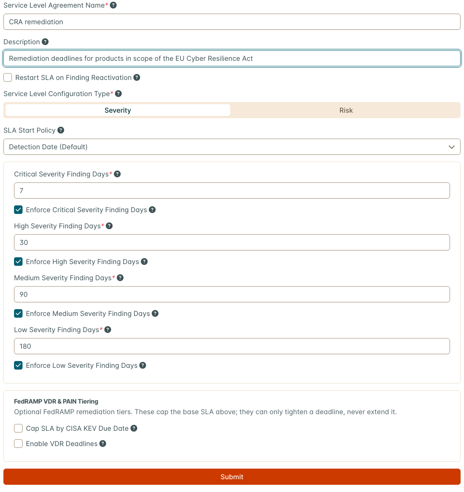

Create a new configuration rather than editing a shipped one such as *Default*. A shipped
configuration is shared by every Asset that uses it, and changing it re-dates their findings too.

| Expected | Where |
| --- | --- |
| *CRA remediation* is listed with your day counts | **Settings > Finding Workflow > Service Level Agreements** |

You assign it to products in Step 8.

### Step 5 — Put CRA on a dashboard

In the left menu, go to **Overview > Dashboards**.

1. Select **New Layout** (the **+** beside the layout name), type a **Layout Name** such as
   *EU CRA*, and select **Submit**. A separate layout keeps the CRA widgets off your default
   dashboard.
2. The new layout is empty. Select the **Add Widget** button in the middle of the page. On the
   **By Type** tab, select **CRA Article 14 Deadlines**. Adding a widget turns on edit mode.
3. Select **Add Widget** again, now the orange **+** at the right of the toolbar, and select
   **Regulatory Scope**.
4. To show only the CRA on **Regulatory Scope**, select the widget's gear (**Edit Widget**), type
   `CRA` in **Regulations**, and save. The gear shows only in edit mode, which adding a widget turns
   on; otherwise select **Edit Layout** (the grid icon at the right of the toolbar) first.
5. Select **Done Editing** (the check mark) to leave edit mode.

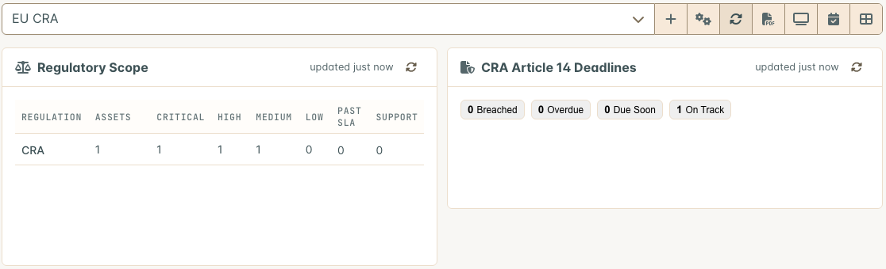

**Regulatory Scope** lists every regulation on your Assets, one row each: the Assets in scope,
their open findings by severity, findings past their deadline, and Assets whose support period has
ended or ends within 90 days. In 3.4.201 and 3.4.202 the per-severity columns undercount (they can
read 1 where there are several findings); rely on the **Assets**, **Past SLA** and **Support**
columns, and on each Asset's own finding counts. It counts an Asset under the CRA from the Asset's **Regulations** (Step 7), not
from its Regulatory card.

**CRA Article 14 Deadlines** counts the open stages of your Article 14 reports as **Breached**,
**Overdue**, **Due Soon** and **On Track**, and lists the most urgent.

| Expected | Where |
| --- | --- |
| Both widgets on the layout. They read empty until Part 2 is done | **Overview > Dashboards**, your *EU CRA* layout |

## Part 2 — Set up each product in scope

Repeat Steps 6 to 9 for each product. For many products, use the API (see the end of Part 2).

### Step 6 — Record the product's regulatory facts

In the left menu, go to **Explore > Assets** and select the product's Asset. The **Regulatory**
card is near the top of the Asset page, below the Engagements, Tests, Findings and Locations tiles.
Fill it in and select **Submit**:

| Field | Example | What it records |
| --- | --- | --- |
| **CRA Product Class** | Important, Class I | Your class determination. **Not Applicable** records that the CRA does not apply, and turns off the CRA prompts for this Asset |
| **Support Period End** | 2031-12-31 | The end of the support period |
| **Security Contact** | `product-security@example.com` | Where vulnerability reports go: an email address or a URL |
| **Disclosure Policy URL** | `https://example.com/security/disclosure-policy` | Your coordinated vulnerability disclosure policy |
| **Notes** | Who made the class determination, when, and where it is recorded | The trail an assessor will ask for |
| **SLA Locked** | Unticked, unless Step 8 says otherwise | Keeps the Asset out of criticality-based SLA assignment |

The empty **Security Contact** and **Disclosure Policy URL** boxes show grey example text. It is a
hint, not a value: type your own.

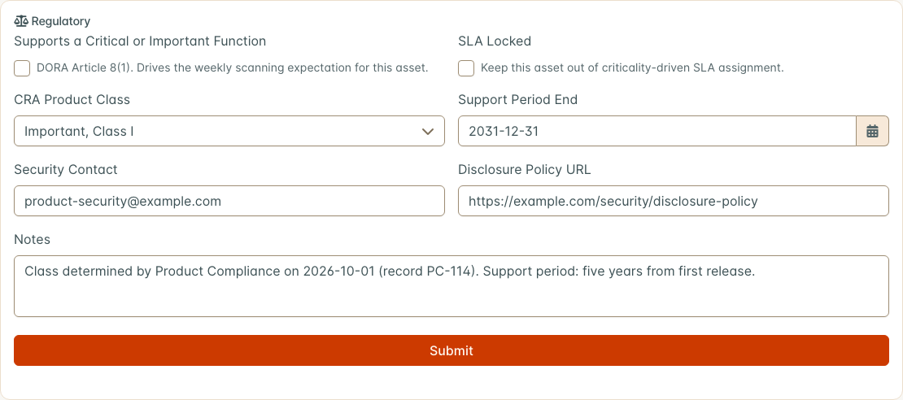

**Supports a Critical or Important Function** is a DORA field; leave it unless DORA applies to you.
Every field is described on [Regulatory Profile](../regulatory_profile/#fields).

| Expected | Where |
| --- | --- |
| The values are still there after you reload the page | The **Regulatory** card |

### Step 7 — Add the CRA regulation

On the same Asset page, select the gear icon at the right end of the row with the Asset's name, and choose
**Edit Asset**. Scroll to **Optional Fields** and open **Regulations**. Type `CRA` in the list's
search box, tick **CRA (European Union)**, and select **Submit** at the bottom of the form.

Search by the acronym: the list shows only the first few regulations until you search, and typing
`Cyber` finds nothing.

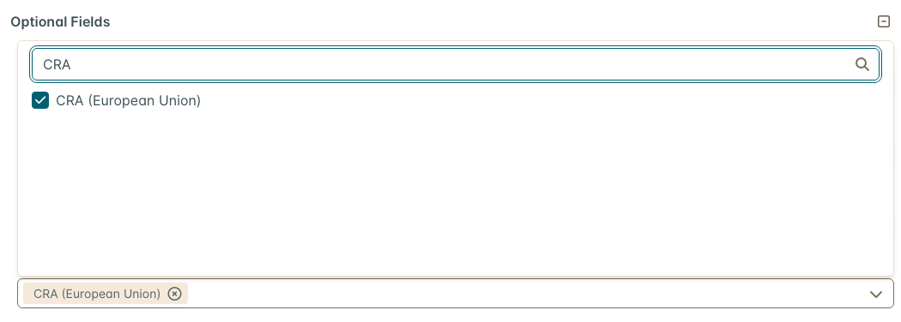

| Expected | Where |
| --- | --- |
| *Cyber Resilience Act (Regulation (EU) 2024/2847) (CRA)* is listed | Asset page > **Asset Overview** > **Regulations** tab |
| The product is counted on the **CRA** row | The **Regulatory Scope** widget (Step 5) |

**You need both Step 6 and Step 7.** The Regulatory Scope widget reads the regulation; the Article
14 prompts and the assessment read the card.

### Step 8 — Assign the remediation policy

Open **Edit Asset** again (gear icon > **Edit Asset**), set **SLA Configuration** to the
configuration from Step 4, and select **Submit**. Changing it recalculates the deadlines of the
Asset's existing findings; the field is locked while that runs.

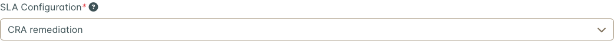

Tick **SLA Locked** on the Regulatory card for a product whose deadlines must not be changed by a
criticality-based assignment, such as one with its own support agreement.

| Expected | Where |
| --- | --- |
| **Service Level Agreement by Severity** names your configuration and its days | The Asset page, below **Asset Overview** |

### Step 9 — Products already on the market

A product placed on the market before 11 December 2027 and not substantially modified since is
outside most of the CRA (Article 69(2)), but Article 14 reporting still applies to it
(Article 69(3)). Set it up like any other product, record the class and support period, and note
the reasoning on the card. The assessment in Step 13 is where requirements that do not apply are
recorded as **Not Applicable**, with that reasoning.

### Setting up many products

The same settings are available through the API, for a script over your product list:

```bash
# Regulatory card for Asset 42
curl -X POST "$DD_URL/api/v2/regulatory_profiles/" \
  -H "Authorization: Token $DD_TOKEN" -H "Content-Type: application/json" \
  -d '{"product": 42, "cra_product_class": "important_class_1", "support_period_end": "2031-12-31",
       "security_contact": "product-security@example.com",
       "cvd_policy_url": "https://example.com/security/disclosure-policy"}'

# CRA regulation and SLA configuration on Asset 42. Look up the ids in /api/v2/regulations/
# and /api/v2/sla_configurations/. "regulations" replaces the Asset's whole list.
curl -X PATCH "$DD_URL/api/v2/products/42/" \
  -H "Authorization: Token $DD_TOKEN" -H "Content-Type: application/json" \
  -d '{"regulations": [27], "sla_configuration": 6}'
```

An Asset has at most one profile; use `PATCH /api/v2/regulatory_profiles/<id>/` to change it. See
[Regulatory Profile](../regulatory_profile/#api).

## Part 3 — Load each release

Repeat Steps 10 and 11 whenever you ship a release.

### Step 10 — Import the release's SBOM

On the Asset page, select the arrow (▼) beside **Locations** on the tile at the top of the page and choose
**Import SBOM**. In the dialog:

1. **SBOM Format:** select **CycloneDX** or **SPDX**. There is no default, and the dialog will not
   submit without one.
2. **File:** select **Choose** and pick the SBOM file.
3. **Version:** the release, for example `4.1`. If there is no **Version** field, Step 2 is not done.
4. Leave **Replace Existing Dependencies** unticked unless this SBOM is the complete picture of
   everything the Asset carries.
5. Select **Submit**.

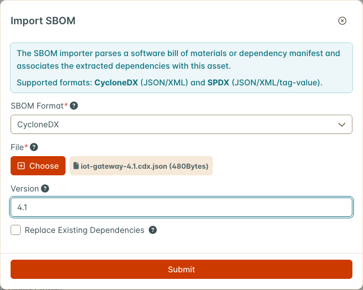

From a build pipeline, post the same fields to the API:

```bash
curl -X POST "$DD_URL/api/v2/sbom-import/" -H "Authorization: Token $DD_TOKEN" \
  -F "product=42" -F "scan_type=CycloneDX" -F "version=4.1" -F "file=@bom.cdx.json"
```

| Expected | Where |
| --- | --- |
| **SBOM Imported** with the number of dependencies processed | A message at the top right |
| The count on the **Locations** tile goes up | The Asset page |
| The release's components | `GET /api/v2/sbom/<asset id>/?spec=cyclonedx&version=4.1`. A version never imported answers *No version '…' for this asset* |

**Export SBOM and VEX**, on the same **Locations** menu, exports the Asset as a whole; a single
release is exported through the API as above.

### Step 11 — Import the release's scan results

Import your scanners' results as usual (gear icon > **Import Scan** on the Asset, a connector, or
your pipeline): SCA, container, SAST and penetration tests. Set **Scan Date** to the day the scan
ran. A finding's deadline runs from its date, and some parsers take that date from the report file,
so an old report imported without a scan date produces findings that are already past their
deadline.

The CRA assessment reads these findings and tests:

* **VH-3** (regular security testing) needs a test whose target end date falls in the period and
  that is a static analysis test, or whose test type, title or scan type contains "scan",
  "vulnerability", "penetration" or "SAST".
* **PI-2(a)** reads open and risk-accepted findings marked **Known Exploited** (Step 3).
* **PI-2(b)** to **PI-2(m)**, apart from (g) and (i), read open findings whose CWE maps to the
  requirement.

| Expected | Where |
| --- | --- |
| Findings with deadlines from your policy, counted from the scan date | The Asset's findings, **SLA** column |
| Findings for CVEs in the KEV catalog marked **Known Exploited** | After enrichment (Step 3) |

## Part 4 — When an actively exploited vulnerability is found

Article 14 requires an early warning within 24 hours of becoming aware of an actively exploited
vulnerability in your product, a notification within 72 hours, and a final report within 14 days
after a corrective or mitigating measure is available. DefectDojo tracks these clocks and builds
each submission package. A person decides when you are aware, and a person submits each stage on
ENISA's Single Reporting Platform.

### Step 12 — Start and track an Article 14 report

**When DefectDojo prompts you.** When an Asset whose **CRA Product Class** is not **Not
Applicable** has an open finding marked **Known Exploited**, the Regulatory card shows **CRA Article
14 Early Warning Due**, listing each such finding with a **Start CRA Report** button. The finding
itself shows a **CRA Early Warning Due** tag beside its title until a report names its CVE.

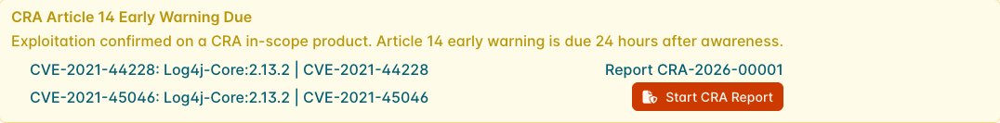

The prompt says *Exploitation confirmed*, but it appears for any finding on the CISA KEV list. It
is a prompt to decide whether you are aware of active exploitation affecting this product, not a
determination. DefectDojo records when the prompt first appeared, because a regulator may ask.

**Start a report only for a real awareness event.** A report cannot be deleted, its clocks cannot
be paused, and it stays even if its Asset is deleted. Practise on a test instance.

1. Select **Start CRA Report** on the finding's row. To start one without a prompt, use **Start
   CRA Report** in the finding's menu, or **Act > CRA Article 14 Reports > New CRA Report** in the
   left menu and pick the Asset yourself.
2. Check **Regime** (**Actively Exploited Vulnerability**, or **Severe Incident**) and choose the
   **Sensitivity**.
3. Give it a **Title**. **Advisory Reference** is filled in with the finding's CVE when you start
   from a finding; separate several CVEs with commas.
4. Awareness is recorded as now. If you became aware earlier, tick **Backdate Awareness Time**,
   enter the **Awareness Time** and a **Reason for Backdating**. The reason is kept on the report's
   audit trail.
5. Select **Start Report**.

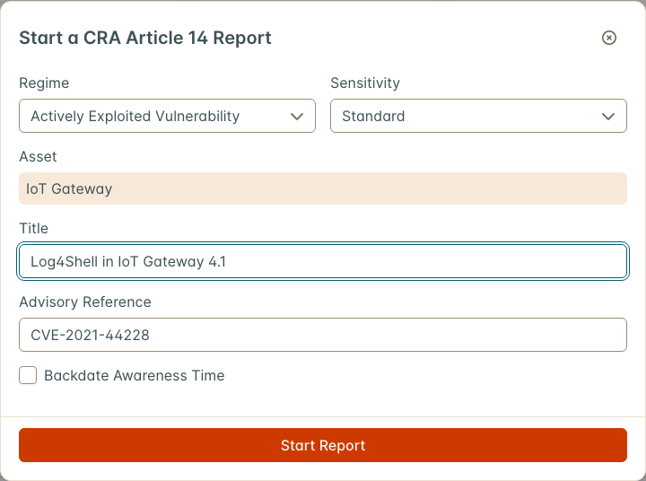

The report gets a reference such as *CRA-2026-00001*, and the prompt shows that reference in place
of the button. To open it, go to **Act > CRA Article 14 Reports** in the left menu, select the
**⋮** menu on its row, and choose **Open**. The list is ordered by the nearest deadline, overdue
first.

| Stage | Due | Starts |
| --- | --- | --- |
| Early Warning | 24 hours after awareness | When the report is started |
| Notification | 72 hours after awareness | When the report is started |
| Final Report | 14 days after the corrective measure is available | When you select **Record Corrective Measure** and enter when it became available. Until then it reads **Not Armed** |

Each stage lists what its submission must contain, and has **JSON**, **Markdown** and **PDF**
downloads of the package. After you submit a stage on ENISA's platform:

1. Type the reference the platform returned in **Reporting-platform reference** on that stage.
2. If you submitted earlier than now, tick **Submitted Earlier Than Now** and enter when.
3. Select **Record Submission**.

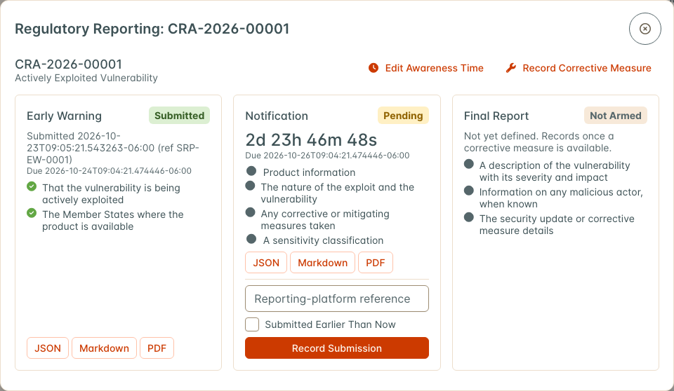

Recording a submission adds a note to each finding on the Asset whose CVE is in **Advisory
Reference**, and to those findings' engagements, with the stage, time and platform reference. It does not change the findings' status.

A check runs every 15 minutes. It sends **CRA deadline due soon** and **CRA deadline breached**
notifications to the users who can view the Asset, and to superusers, through the channels each
person chose for **Other** events (**Settings > Notifications > Personal Notifications**). A missed
deadline is recorded and does not clear: a stage submitted after its deadline closes as breached,
not met. Record each submission as soon as you make it.

A severe incident follows the same 24 and 72 hour stages, with a final report one calendar month
after the notification is submitted. See [CRA Article 14 Reporting](../cra_article14_reporting/).

## Part 5 — Produce evidence each period

### Step 13 — Assess the product

On the Asset page, open the **Compliance** tab under **Asset Overview** and select **Compliance
Profile**. Open the **EU Evidence** tab and select **Start Assessment**. In the dialog:

1. **Catalog:** **EU CRA Vulnerability Handling**.
2. **Period Start** and **Period End:** the period you are assessing, for example a quarter.
3. **Release Assessed:** the release, if the assessment is for one release.
4. **Notes:** optional.
5. Select **Start Assessment**, then **Recompute Evidence**.

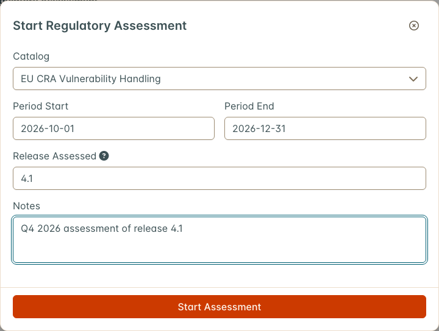

**Release Assessed** labels the assessment and its evidence pack; the evidence is still read for the
whole Asset over the period. When an Asset has several assessments, choose one in the
**Assessment** list, or open it with **Review** under **Regulatory Assessments** on the **Profile**
tab, which shows each period.

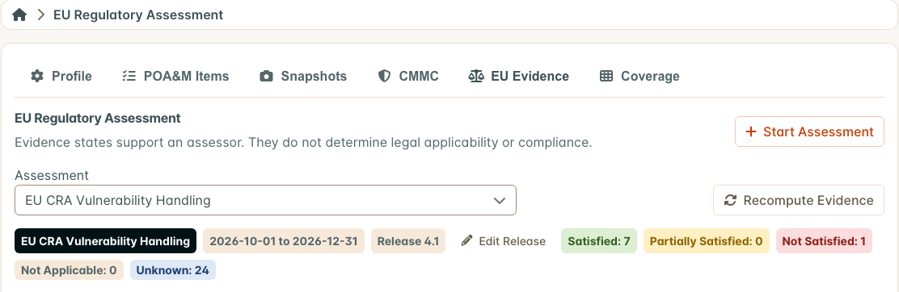

The assessment has 32 requirements. Once Parts 1 to 3 are done, expect:

| Requirement | Expected | Set by |
| --- | --- | --- |
| **VH-1** Identify and document components | Satisfied | An SBOM imported in the period (Step 10) |
| **VH-2** Remediate without delay | Satisfied while no more than 5% of open findings are past their deadline and no risk acceptance has expired unhandled | The policy (Steps 4 and 8) and your remediation |
| **VH-3** Regular security testing | Satisfied when a test in the period meets the rule in Step 11 | Your scan imports (Step 11) |
| **VH-4** Disclose fixed vulnerabilities | Unknown | Recorded by hand: see below |
| **VH-5** Coordinated vulnerability disclosure | Satisfied | **Disclosure Policy URL** on the Regulatory card (Step 6) |
| **VH-6** Vulnerability reporting contact | Satisfied | **Security Contact** on the Regulatory card (Step 6) |
| **PI-2(a)** No known exploitable vulnerabilities | Not Satisfied while a **Known Exploited** finding is open or risk-accepted. Satisfied when there is none, a test ran in the period and a KEV enrichment run completed within 7 days; otherwise Unknown | Enrichment (Step 3) and your remediation |
| Other **PI-2** requirements | Not Satisfied (Critical or High) or Partially Satisfied when open findings carry a CWE mapped to the requirement; otherwise Unknown | Your findings |
| **RP-1** to **RP-6** Article 14 stages | Satisfied when every stage of that kind due or submitted in the period was submitted on time; Not Satisfied if one was late or missed; Unknown when none was due or submitted in the period yet | Your Article 14 reports (Step 12) |
| The rest | Unknown | Recorded by hand |

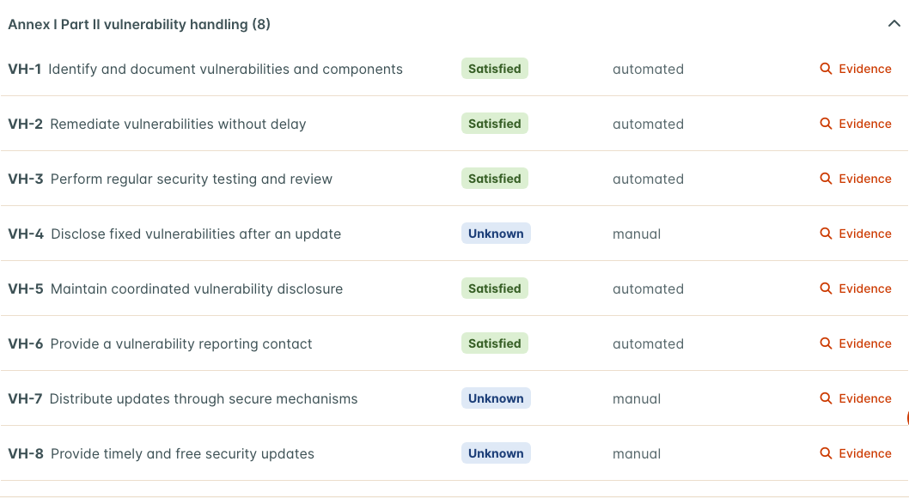

Recompute whenever the data changes, and before generating a pack. The rules behind each automated
state are on [CRA and DORA Evidence Packs](../eu_evidence_packs/#automated-evidence).

### Record what DefectDojo cannot measure

Select **Evidence** on a requirement's row to see its computed facts, including a note on what to
record. To set its state by hand:

1. Change **Evidence State**.
2. Fill in the **Override Reason** that appears (**Why This Requirement Does Not Apply** when you
   choose **Not Applicable**). **Submit** stays disabled without one.
3. Write an **Assessor Narrative**.
4. Attach supporting documents with **Attach a File**.
5. Select **Submit**.

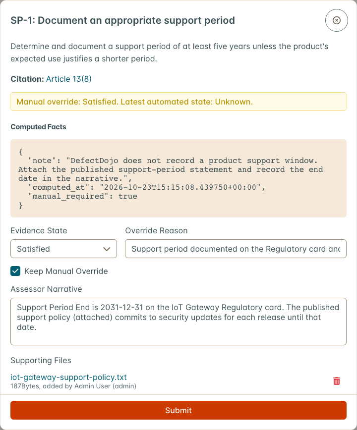

| Requirement | Evidence to record |
| --- | --- |
| **VH-4** Disclose fixed vulnerabilities | Your published security advisories, release notes or changelog entries for the vulnerabilities fixed in the period. The computed facts list the vulnerability IDs of findings mitigated in the period, under `fixed_vulnerability_ids` |
| **SP-1**, **SP-2** Support period | The **Support Period End** from Step 6, and your published support policy as a file. For a product covered by Article 69(2) (Step 9), set them **Not Applicable** with that reasoning |
| **RP-1** to **RP-6**, when Unknown | That no Article 14 event occurred in the period, if that is your determination |
| **RP-7** Inform impacted users | How you informed users of the vulnerability and the corrective measures |
| **PI** requirements | How each is implemented. A narrative is required before one can be set Satisfied or Partially Satisfied |

A recompute never replaces a state set by hand: the Evidence view shows *Manual override* with the
latest automated state beside it. Untick **Keep Manual Override** and select **Submit** to return to
the automated state.

### Step 14 — Freeze the evidence

On the assessment, select **Recompute Evidence**, then **Generate Evidence Pack**. The pack is built
in the background; reload the page after a few seconds.

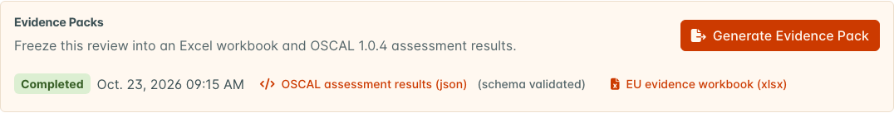

| Expected | Where |
| --- | --- |
| A **Completed** pack with **OSCAL assessment results (json)**, marked *schema validated*, and **EU evidence workbook (xlsx)** | **Evidence Packs** on the assessment |

A pack is a frozen snapshot that later changes never alter. Generate one at the end of each period,
and keep the downloads with your technical documentation. See
[Generate an evidence pack](../eu_evidence_packs/#generate-an-evidence-pack).

## Check your setup

| Check | Expected |
| --- | --- |
| Each in-scope product's **Regulatory** card | Class, support period end, contact and policy URL filled in |
| The **Regulatory Scope** widget | Every in-scope product counted on the CRA row |
| Each in-scope product's **Service Level Agreement by Severity** | Your CRA policy |
| The latest release of each product | An SBOM imported with its **Version** |
| A finding for a CVE in the CISA KEV catalog | Marked **Known Exploited** |
| **Act > CRA Article 14 Reports** | The page opens with **New CRA Report**; your team knows who decides awareness and who submits |
| **Settings > Notifications > Personal Notifications** | The people who own Article 14 have a channel set for **Other** events |
| A current-period assessment per product, recomputed | VH-1, VH-2, VH-3, VH-5 and VH-6 Satisfied, or a known reason they are not; manual requirements recorded |

## Moving to a production workflow

* **Automate the per-release steps.** Post the SBOM with its version and the scan results from the
  same pipeline job that builds the release, so Steps 10 and 11 never depend on someone remembering.
* **Agree the awareness decision in advance.** Name who looks at a **CRA Article 14 Early Warning
  Due** prompt, how fast, and who submits to ENISA. The 24-hour clock starts at awareness, not when
  someone gets round to it.
* **Assess on a fixed cycle.** Start each period's assessment at the start of the period, recompute
  as you go, and generate the pack at the end.

## Troubleshooting

| Symptom | Cause | Fix |
| --- | --- | --- |
| No **Regulatory** card, or no **CRA Article 14 Reports** in the left menu | **Regulatory Profile** is off | Step 1 |
| No **EU Evidence** tab | **EU Evidence Packs** or **Compliance** is off | Step 1 |
| No **CRA Article 14 Deadlines** in **Add Widget** | **Regulatory Profile** is off | Step 1 |
| No **Version** field in **Import SBOM** | Per-release SBOMs are not enabled | Step 2 |
| The SLA form will not save | The day counts are placeholders, not values | Type a number in each box (Step 4) |
| CRA is missing from the **Regulations** list | The list shows only the first few until you search | Type `CRA` in its search box (Step 7) |
| A product is missing from the **Regulatory Scope** widget | The CRA regulation is not on the Asset | Step 7 |
| The **Regulatory Scope** severity columns are lower than the Asset's open findings | A known undercount in 3.4.201 and 3.4.202 (Step 5) | Use **Assets**, **Past SLA** and the Asset's own finding counts |
| **Known Exploited** is never set on imported findings | Enrichment is not running | Step 3; on Cloud, contact DefectDojo Support |
| No early-warning prompt for a **Known Exploited** finding | **CRA Product Class** is **Not Applicable**, or the finding is not active | Step 6 |
| Findings are past their deadline right after import, and **VH-2** is Partially Satisfied | The report file carries an old date, and no **Scan Date** was set | Re-import with **Scan Date** set (Step 11) |
| **VH-1** Not Satisfied | No SBOM components on the Asset | Step 10 |
| **VH-1** Partially Satisfied right after an SBOM import | Component records are shared across the instance, so a component another product already carried keeps its original date | Expected. Document the SBOM review in the narrative |
| **VH-2** Not Satisfied | The Asset's SLA configuration enforces no severity | Steps 4 and 8 |
| **VH-2** Partially Satisfied | More than 5% of open findings are past their deadline, or a risk acceptance has expired unhandled | Remediate, or renew or close the expired acceptance |
| **VH-3** Not Satisfied with tests in the period | No test meets the rule in Step 11, or its target end date is outside the period | Rename the test, or import under a scan type whose name says so |
| **VH-5** or **VH-6** Unknown | The Regulatory card has no **Disclosure Policy URL** or **Security Contact** | Step 6, then **Recompute Evidence** |
| **PI-2(a)** Unknown, not Satisfied | No test in the period, or no KEV enrichment run in the last 7 days | Read `tests_in_period`, `kev_run_age_days` and `kev_source_seen` in its computed facts; see Step 3 |
| *Describe how this requirement is implemented before marking it met* | A PI requirement set Satisfied or Partially Satisfied without a narrative | Write the narrative |
| An assessment from an earlier release has 18 requirements | It was started before the Annex I Part I requirements were added | **Recompute Evidence** adds them. A pack generated earlier keeps the 18 it froze |
| A submitted stage reads **breached** | Its deadline passed before the submission was recorded | It cannot be changed. Record submissions as soon as they are made |
| The final report reads **Not Armed** | No corrective measure recorded | **Record Corrective Measure** |
| An Article 14 report cannot be deleted | By design | Start reports only for real awareness events |

## What is not surfaced today

So nobody spends time hunting for these:

* **No screen lists per-release SBOMs.** They are stored per version and exported through the API.
* **The Article 14 report's audit trail has no screen.** The awareness reason is in each stage's
  **JSON** download.
* **No dashboard widget or report reads assessment states or CRA classes.** They are on the EU
  Evidence tab and in the evidence pack.
* **SP-1, SP-2, VH-4 and RP-7 are not computed.** SP-1 does not read **Support Period End** from
  the Regulatory card; the assessor records it.
* **No PDF evidence pack.** The workbook and the OSCAL file are the pack.
