DefectDojo Pro includes authored catalogs for vulnerability-related obligations in the Cyber
Resilience Act (CRA) and Digital Operational Resilience Act (DORA). A regulatory assessment
collects the operational facts DefectDojo already holds, gives an assessor space to document the
remaining evidence, and produces a dated evidence pack.

DefectDojo does not determine whether a regulation applies to an organization, product, or
service. The catalogs and evidence states are aids to assessment. Confirm applicability,
interpretation, and conclusions with qualified legal and compliance reviewers.

## Enable EU evidence packs

EU evidence packs require the **Compliance** feature and the beta **EU Evidence Packs** feature.
An administrator can enable both from [Feature Flags](/admin/feature_flags/pro__feature_flags/).
EU Evidence Packs depends on Compliance, so it stays off while Compliance is off.

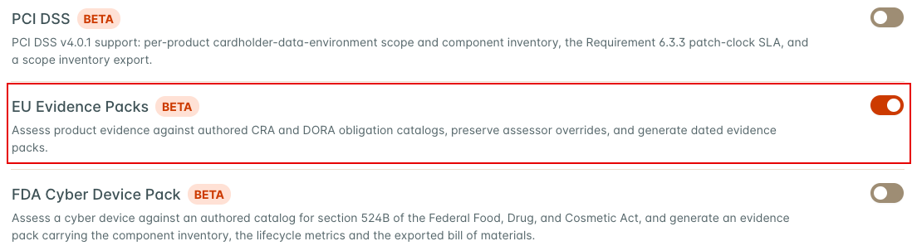

Anyone who can view an Asset can open its assessments, download its evidence packs, and download
the files attached to its obligations. Starting an assessment, recomputing evidence, saving a
review, attaching or removing a file, and generating a pack require edit permission on the Asset.
Users without it do not see those buttons. An assessment that covers more than one Asset needs
view permission on every Asset it covers to be opened, and edit permission on every one of them
to be changed.

## Included catalogs

The bundled catalogs contain short, authored paraphrases. Each obligation records its citation
and links to the corresponding source on EUR-Lex.

The CRA catalog covers Annex I Part II vulnerability handling, the Article 13 support period and
component due diligence requirements, the Article 14 vulnerability and incident reporting
stages, and the Annex I Part I product security requirements (see
[Annex I Part I product security requirements](#annex-i-part-i-product-security-requirements)).

The DORA catalog covers ICT asset identification, vulnerability and patch management under
Commission Delegated Regulation (EU) 2024/1774, the testing types in DORA Article 25(1), and the
Article 28(3) third-party register. The third-party register obligation starts as not applicable
because the evidence pack does not manage that register.

The catalog text summarizes assessment topics and does not replace the regulations.

## Start and recompute an assessment

Assessments live on the Asset's Compliance Profile. Open the Asset, select the **Compliance** tab
in the Asset Overview, then select **Compliance Profile**.

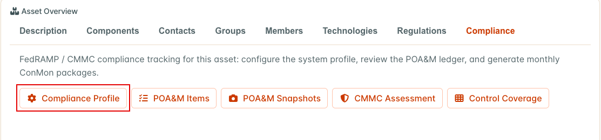

The Compliance Profile page has a **Regulatory Assessments** section that lists existing
assessments, each with a **Review** button, and offers one start button for each regulatory
catalog. Those start buttons always use a period from January 1 of the current year to today.
Each one opens a short dialog that asks for the optional **Release Assessed** before it starts the
assessment. To choose the period yourself, open the **EU Evidence** tab and select
**Start Assessment**.

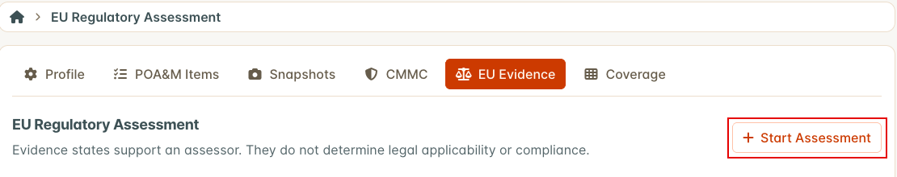

In the **Start Regulatory Assessment** dialog, pick the **Catalog**, set **Period Start** and
**Period End**, add the optional **Release Assessed** and **Notes**, and select
**Start Assessment**. The period end cannot be
earlier than the period start. Both dates are included in the period.

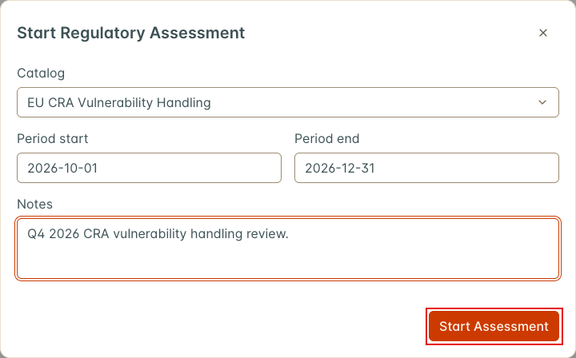

A new assessment creates an evidence result for every obligation in the catalog. Every result
starts as unknown, because nothing has been computed yet.

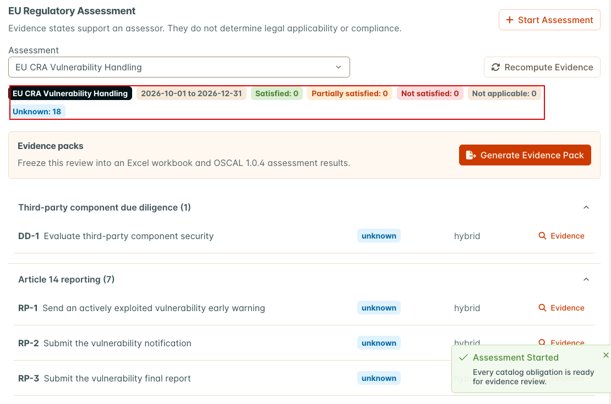

Select **Recompute Evidence** to compute the automated evidence. DefectDojo shows **Evidence
Recomputed** when it finishes, and the summary above the obligations shows how many are in each
state. Recompute again whenever the underlying data changes, and before you generate a pack.

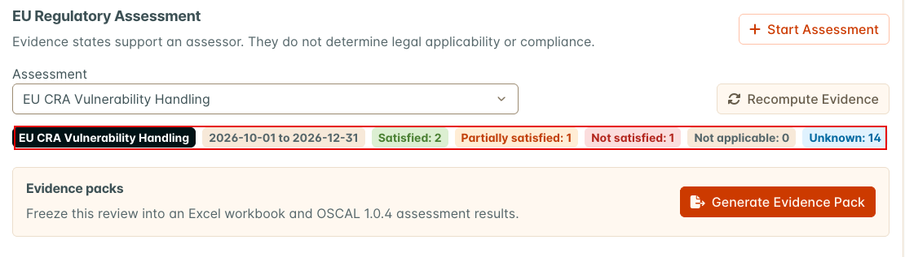

Recomputing refreshes the computed facts and the automated state of every obligation. It does not
change narratives, attachments, or any state an assessor has overridden. It runs while you wait,
so a large Asset can take a while.

The assessment uses five evidence states: satisfied, partially satisfied, not satisfied, not
applicable, and unknown. These states describe the evidence in DefectDojo. They are not legal
conclusions.

Obligations are grouped by family. Each row shows the evidence state, how the state was reached
(automated, manual, or hybrid), and an **Evidence** button.

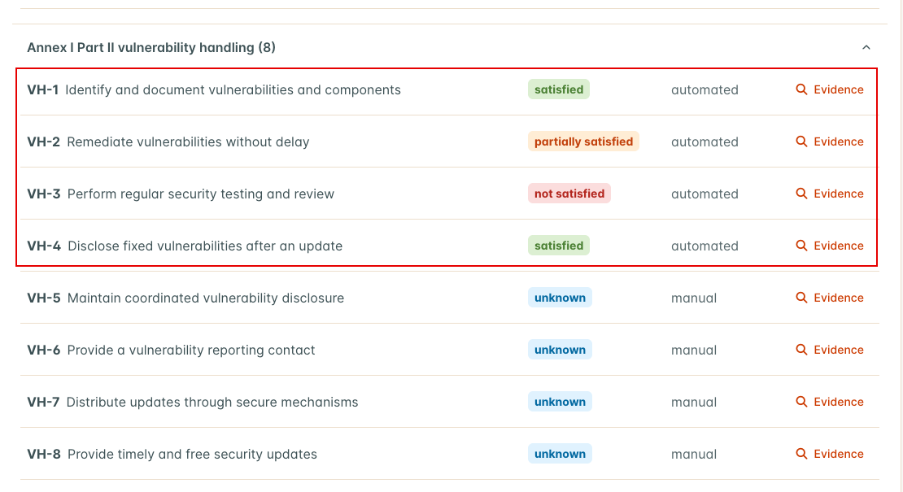

## Automated evidence

DefectDojo computes evidence only where it has suitable operational facts.

| Evidence source | Obligations it can support |
| --- | --- |
| SBOM dependency locations | CRA component and SBOM evidence; DORA third-party and open source library tracking |
| SLA settings, finding history, and risk acceptances | CRA remediation; DORA patch priority, deadlines, remediation monitoring, and vulnerability records |
| Tests and engagements in the assessment period | Regular security testing, vulnerability scanning, source code review, and penetration testing |
| EPSS and KEV enrichment runs | Trustworthy vulnerability information sources |
| Asset business criticality | ICT asset classification |
| Published PSIRT advisories | Public disclosure of fixed vulnerabilities |

Where DefectDojo holds no record for an obligation, the result stays unknown and its note names
the evidence to record. Other obligations are manual by design.

### CRA rules

The **evidence date** is the period end, or today if the period has not ended yet. Rules that
look at the state of findings or components use that date. Dates are compared in the server's
time zone.

| Obligation | Satisfied | Otherwise |
| --- | --- | --- |
| VH-1 Identify and document vulnerabilities and components | The Asset has SBOM components, and the newest component record was created inside the period. | Partially satisfied if the newest component record is older than the period. Not satisfied if the Asset has no SBOM components. |
| VH-2 Remediate vulnerabilities without delay | The Asset has an SLA configuration that enforces at least one severity, no more than 5% of the findings open on the evidence date are past their SLA, and no risk acceptance has expired without being handled. | Not satisfied if no SLA is enforced. Partially satisfied if more than 5% of open findings are past SLA or an expired risk acceptance is unhandled. |
| VH-3 Perform regular security testing and review | At least one test with a target end date inside the period is a static analysis test type, or has "scan", "vulnerability", "penetration", or "sast" in its test type name, title, or scan type. | Not satisfied. |
| VH-4 Disclose fixed vulnerabilities after an update | At least one PSIRT advisory counts toward the Asset (see below). | Unknown, with the note "No published advisories were linked in the period; confirm whether disclosure was required." |

Open findings exclude false positives, duplicates, and out-of-scope findings. VH-2 also reports
the share of findings closed within SLA during the period, the mean time to remediate by
severity, and risk acceptance counts. VH-3 also reports the longest gap between matching tests.
These extra facts are for the assessor and do not change the state.

A PSIRT advisory counts toward VH-4 for an Asset when all three of these hold:

* Its status is published, revised, or superseded. Draft, review, and approved advisories do not
  count, so in practice any advisory that has been published can count.
* Its publication date falls inside the assessment period, including the start and end dates.
* The Asset is one of its recipients, as listed in the advisory's **Recipients** panel. An Asset
  is **matched** when a live match in one of the advisory's cases names the Asset or a component
  the Asset carries. Retracted and false positive matches do not count. An Asset is **added by
  hand** when someone targets the Asset, or its whole Organization, as a recipient. An exclusion
  on the Asset or its Organization removes it from the recipients either way.

If the PSIRT Advisory Engine is unavailable, VH-4 stays unknown with the note "The PSIRT Advisory
Engine is unavailable; record disclosure evidence manually."

The remaining CRA obligations stay unknown until an assessor sets them. VH-5, VH-6, SP-1, and
RP-1 to RP-6 carry a note that says what evidence to record. VH-7, VH-8, SP-2, RP-7, and DD-1 note
that no automated check is registered for them.

### Reading the computed facts

Select **Evidence** on a row to see the obligation text, its citation, and the **Computed Facts**
behind the state. The facts record when they were computed (`computed_at`), and automated facts
also record the evidence date they used (`as_of`).

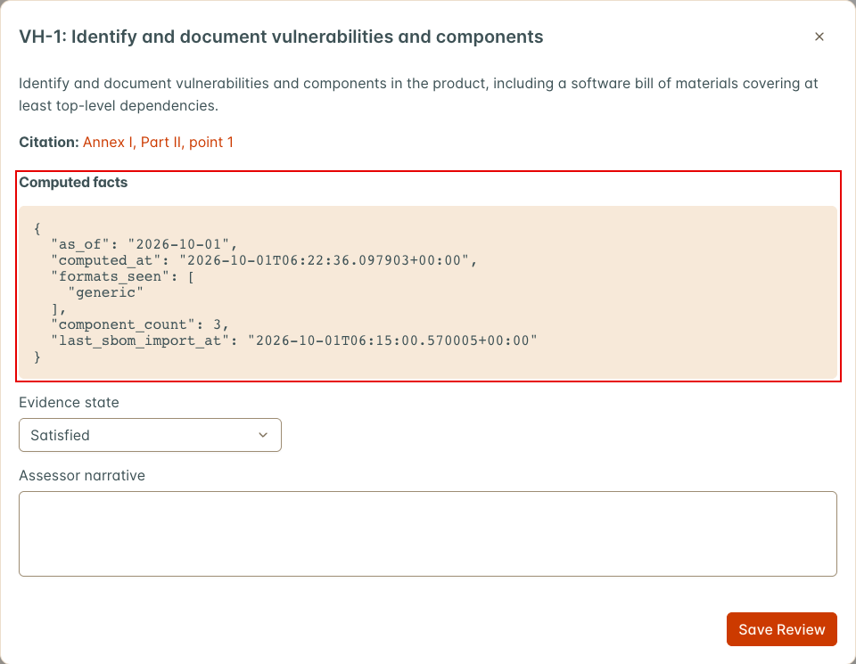

For VH-4, `published_advisory_count` is the number of advisories that count toward the Asset and
`advisory_ids` lists them. When none count, the facts also carry `manual_required: true` and the
note.

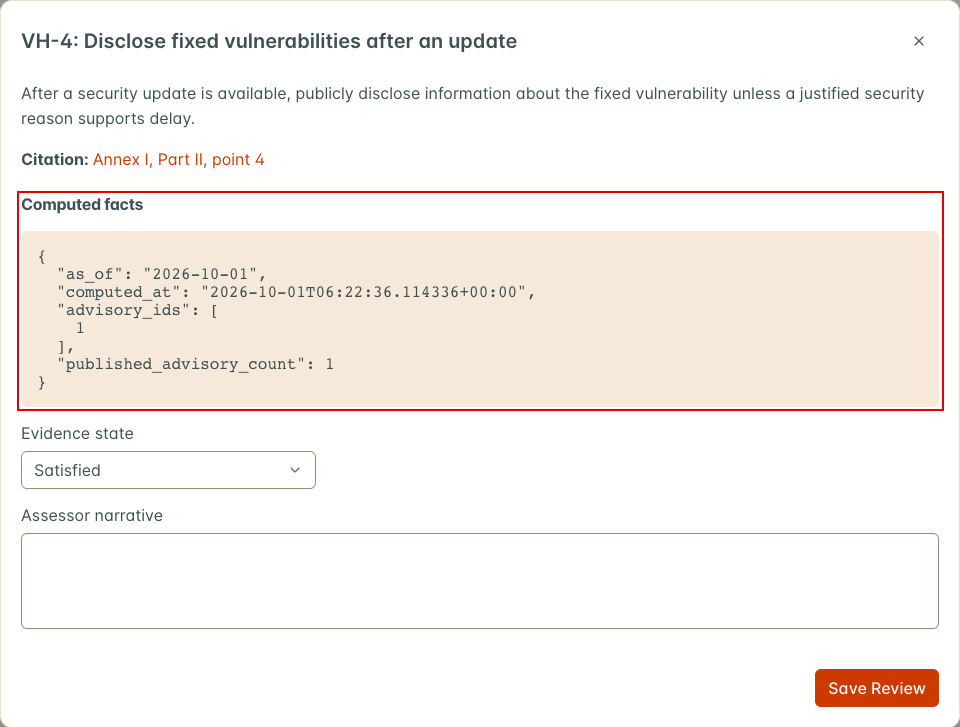

If a computation fails for one obligation, its facts say **Automated evidence is unavailable:**
followed by the error, and its state stays unknown. The other obligations are still computed.

## Annex I Part I product security requirements

The CRA catalog includes the 13 product security requirements in Annex I Part I: point 1 (PI-1)
and points 2(a) to 2(m) (PI-2(a) to PI-2(m)). They appear as their own family on the assessment
page. A new CRA assessment includes them. An existing CRA assessment picks them up, as unknown,
the next time it is recomputed. Nothing else about the existing assessment changes.

Article 13 asks the manufacturer's cybersecurity risk assessment to say, for each of these
requirements, whether it applies to the product and how it is implemented, and to justify any
requirement that does not apply. Record that for each requirement in its **Evidence** view:

* If the requirement does not apply, set **Evidence State** to **Not Applicable**. The reason
  field is labeled **Why This Requirement Does Not Apply**, and what you enter is the
  justification recorded for the technical documentation (Article 13(4)).
* If it applies, set the state and describe how the requirement is implemented in
  **Assessor Narrative**. A narrative is required before a Part I requirement can be set to
  **Satisfied** or **Partially Satisfied** by hand. Without one, the save is refused with the
  message "Describe how this requirement is implemented before marking it met." Clearing the
  narrative on a requirement already set that way is refused too.
* Attach the evidence under **Supporting Files**, such as the risk assessment, a design record or
  a test report.

### What automation does for Part I

PI-1, PI-2(g) and PI-2(i) are manual. DefectDojo holds no record of the risk assessment, the data
the product processes or its effect on other networks, so they stay unknown with a note naming
what to attach.

PI-2(a) asks that the product is made available without known exploitable vulnerabilities, and
DefectDojo checks it against findings flagged as known exploited (the CISA KEV list):

| State | When |
| --- | --- |
| Not satisfied | At least one finding open on the evidence date is known exploited, or a risk-accepted finding is known exploited. Accepting the risk does not remove the vulnerability, so accepted findings count. |
| Satisfied | No such finding, at least one test has a target end date inside the period, and a known exploited enrichment run finished within 7 days before the evidence date. |
| Unknown | No such finding, but there is no test in the period or no recent known exploited enrichment run. The note says which is missing. |

False positives, duplicates, out-of-scope findings and findings mitigated before the evidence date
are not counted. The computed facts list the known exploited finding ids and also count open
findings with an EPSS percentile of 0.95 or higher. That count is for the assessor and never
changes the state.

The other ten requirements can only be flagged as gaps. Each has a set of CWE weaknesses, and an
open finding with one of those CWEs shows a gap against it. A finding without a CWE says nothing
either way, and having no matching findings does not show that a control exists. So these
requirements are never set to satisfied by automation:

* **Not satisfied** when a matching open finding is Critical or High.
* **Partially satisfied** when matching open findings are Medium, Low or Info only.
* **Unknown** when nothing matches, so the assessor records how the requirement is met.

| Requirement | CWEs that show a gap |
| --- | --- |
| PI-2(b) Secure by default configuration | 276, 453, 1188, 1392, 1393 |
| PI-2(c) Security updates | 1104, 1277, 1329 |
| PI-2(d) Protection from unauthorised access | 22, 23, 36, 250, 269, 284, 285, 287, 288, 290, 294, 306, 307, 521, 613, 620, 639, 640, 798, 862, 863, 918, 1390, 1391 |
| PI-2(e) Confidentiality of data | 200, 201, 209, 295, 297, 311, 312, 313, 319, 321, 326, 327, 328, 338, 359, 532, 916 |
| PI-2(f) Integrity of data, commands, programs and configuration | 20, 74, 77, 78, 79, 89, 91, 94, 345, 347, 352, 353, 354, 434, 494, 502, 611, 829, 915 |
| PI-2(h) Availability of essential functions | 400, 405, 409, 674, 770, 776, 835, 1333 |
| PI-2(j) Limited attack surfaces | 215, 489, 668, 749, 912 |
| PI-2(k) Exploitation mitigation | 119, 120, 121, 122, 125, 131, 134, 190, 191, 415, 416, 476, 680, 787, 824 |
| PI-2(l) Security logging and monitoring | 117, 223, 778 |
| PI-2(m) Secure removal and transfer of data | 212, 226, 459 |

Each CWE belongs to one requirement only. The computed facts list the matching finding ids, their
count by severity and the CWEs seen, and `open_findings_without_cwe` counts the open findings that
carry no CWE, so the assessor can judge how much of the backlog the check could see.

As with every obligation on this page, these evidence states support an assessor. They do not
determine legal applicability or compliance.

### The release assessed

Conformity is assessed for a released version of the product, and Annex VII point 1(b) asks the
technical documentation to name the software versions that affect it. An assessment can record
the release it covers in **Release Assessed** (up to 128 characters). Set it when the assessment
is started, or later with **Edit Release** next to the evidence period on the assessment page.
The release appears beside the period on the page and in the evidence pack.

The release labels the assessment. The evidence itself is still read for the assessment period,
not filtered to that release.

## Narratives, attachments, and overrides

Open an obligation's **Evidence** view to inspect the computed facts and record an assessor
narrative. Select **Save Review** to keep your changes.

An assessor can override the effective evidence state. Change **Evidence State**, fill in the
**Override Reason** field that appears, and select **Save Review**. A reason is required.

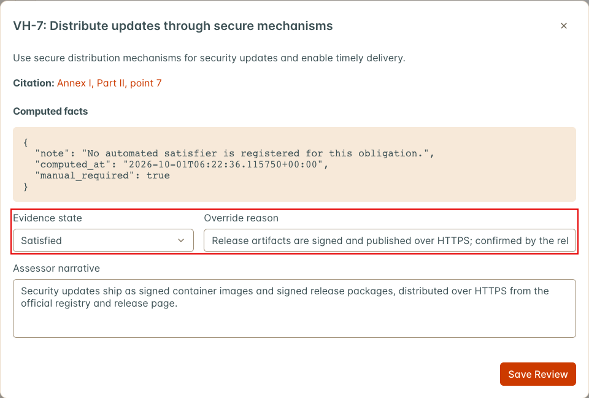

Recomputing does not replace that decision. DefectDojo retains the latest automated state beside
the effective state so reviewers can see when they differ, along with who made the override and
when. To return to the automated state, clear **Keep Manual Override** and select **Save Review**.

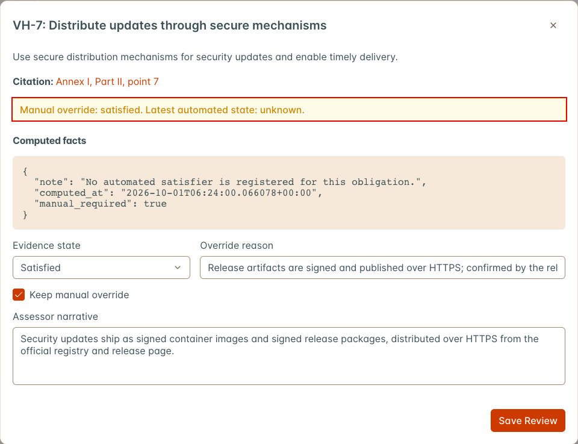

### Supporting files

Some obligation notes ask you to attach a document, such as a vulnerability disclosure policy or
a penetration test report. Attach it in the obligation's **Evidence** view, under
**Supporting Files**:

1. Select **Attach a File** and choose the file. DefectDojo uploads it straight away and lists it
   with its size and who added it.
2. To download a file, select its title. Files are always downloaded, never opened in the
   browser.
3. To remove a file, select the trash icon beside it and confirm. Removing a file deletes it.

The file types allowed are the ones set by `DD_FILE_UPLOAD_TYPES` plus common image types. The
default size limit is 10 MB per file; an administrator can change it with
`DD_OBLIGATION_ATTACHMENT_MAX_BYTES`, in bytes. Each file belongs to one obligation. Deleting the
obligation's result, the assessment, or the Asset deletes its files too. DefectDojo records the
file's SHA-256 digest when it is uploaded, and keeps an audit record of every file that is
attached or removed, with who did it and when.

For automation, the same operations are available on `/api/v2/obligation_results/<id>/attachments/`:
`GET` lists the files, `POST` with a multipart `file` (and an optional `title`) attaches one,
`GET <file id>/download/` downloads one, and `DELETE <file id>/` removes one.

## Generate an evidence pack

Select **Generate Evidence Pack** from the assessment. DefectDojo queues the pack and builds it in
the background. The pack's row shows its status (pending, processing, completed, or failed) and
its generated time. When it completes, the row links to both artifacts. If generation fails, DefectDojo shows
**Evidence Pack Failed** with the error message.

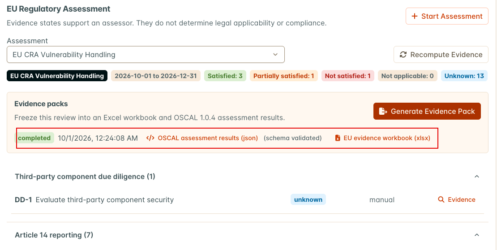

Generation freezes the assessment and its results at that point in time. It uses the stored
states and does not recompute first, so recompute before you generate.
A pack does not update after later changes, and the UI does not flag it as out of date. Recompute,
then generate a new pack. Check the snapshot's generated time.

The pack contains two downloadable artifacts:

* An Excel workbook. The **Cover** sheet shows the Asset, catalog and version, evidence period,
  release assessed (**Not recorded** when none was set), assessment status, and the number of obligations in each state. Each obligation family has its
  own sheet with the obligation, title, citation, status, evidence mode, automated status,
  assessor narrative, and override reason. A **Raw Evidence** sheet adds the computed evidence and
  the supporting files for every obligation, each listed by title with its full SHA-256 digest,
  and a **Shared Evidence** sheet appears when evidence is shared with other frameworks.
* An OSCAL 1.0.4 assessment-results JSON document. DefectDojo validates it against the vendored
  NIST schema before making it available, and the link is marked **(schema validated)**. When
  the assessment records a release, the result carries it as a `product-release` property in the
  DefectDojo namespace. Each
  supporting file is a back-matter resource carrying its SHA-256 hash, referenced as relevant
  evidence from its obligation's observation.

The pack does not contain the files themselves. The digest lets a reviewer confirm that a file
they were given is the one that was assessed. A file attached after a pack was generated, or
removed from the obligation, does not change that pack.

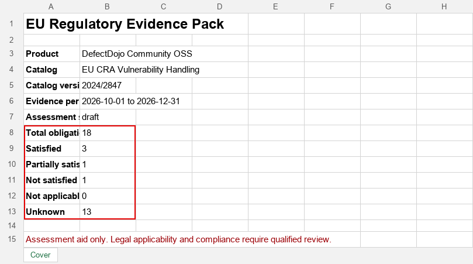

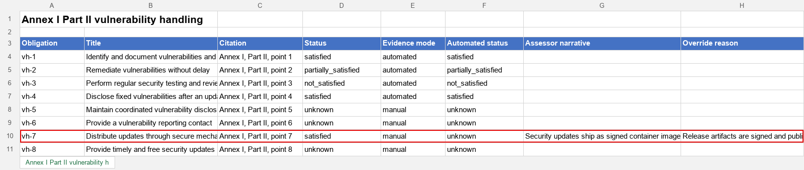

Each artifact records its file size and SHA-256 digest. The assessment page does not show them;
read them from `/api/v2/evidence_pack_artifacts/`. PDF output is not available.

## Troubleshooting

| Symptom | Cause | Fix |
| --- | --- | --- |
| No **EU Evidence** tab and no **Regulatory Assessments** section | **EU Evidence Packs** or **Compliance** is off | Enable both in Feature Flags |
| No **Start Assessment**, **Recompute Evidence**, **Generate Evidence Pack**, **Save Review**, or **Attach a File** | You can view the Asset but not edit it | Ask for a role with edit permission on the Asset |
| Every obligation is unknown | Evidence has not been recomputed successfully yet | Select **Recompute Evidence** and wait for **Evidence Recomputed** |
| **Evidence Not Recomputed** | The recompute request failed | Open the browser's Network tab, recompute again, and check the status of the `recompute/` request. 403: a feature flag is off or you lack edit permission. 500: a server error, so check the application logs for a traceback. 502 or 504: a proxy or app server timeout, so raise the timeout for large Assets |
| Facts say **Automated evidence is unavailable** | That obligation's computation raised an error | Check the application logs for "Evidence satisfier for" and the obligation id |
| VH-1 is not satisfied | The Asset has no SBOM components | Import an SBOM for the Asset, then recompute |
| VH-1 is partially satisfied | Every component record was created before the period | Expected when no new components appeared in the period. Document the SBOM review in the narrative |
| VH-2 is not satisfied and `sla_configured` is false | The Asset's SLA configuration enforces no severity | Assign an SLA configuration that enforces at least one severity, then recompute |
| VH-2 is partially satisfied | More than 5% of open findings are past SLA, or an expired risk acceptance is unhandled | Check `breach_percent` and `risk_acceptances_expired_unhandled` in the computed facts |
| VH-3 is not satisfied although the Asset has tests | No test in the period matches the rule | Check the test type, title, and target end date against the VH-3 rule |
| VH-4 is unknown | No advisory counts toward the Asset: none has been published, it was published outside the period, the Asset is not among its recipients or is excluded, or PSIRT is not enabled | Open the advisory and check its status, publication date, and **Recipients** panel, then recompute. If no disclosure was needed, record why in the narrative |
| A Part I requirement will not save as satisfied or partially satisfied | The requirement has no narrative | Describe how the requirement is implemented in **Assessor Narrative**, then save again |
| PI-2(a) is unknown | No test has a target end date in the period, or no known exploited enrichment run finished within 7 days before the evidence date | Read the note in the computed facts, run the missing scan or enrichment, then recompute. Or attach evidence that the release was checked against known exploited vulnerabilities |
| A pack stays pending or processing | Background task processing is not running | Check with your administrator |
| **Evidence Pack Not Generated** | DefectDojo refused the request, for example because the assessment has no obligations | Read the message in the notification |
| A pack shows old states | A pack is a frozen snapshot | Recompute, then generate a new pack. Check the snapshot's generated time |
| **File Not Attached** saying the type cannot be attached | The file's extension is not in the allowed list | Convert the file to an allowed type, or ask an administrator to add the extension to `DD_FILE_UPLOAD_TYPES` |
| **File Not Attached** saying the file is larger than the limit | The file exceeds the attachment size limit (10 MB by default) | Reduce the file, or ask an administrator to raise `DD_OBLIGATION_ATTACHMENT_MAX_BYTES` |

## Related pages

The [FDA Cyber Device Pack](../fda_cyber_device_pack) uses the same assessment screens and export
pipeline. The [Compliance Profile](../compliance_profile) page describes the rest of the Asset's
compliance settings.
